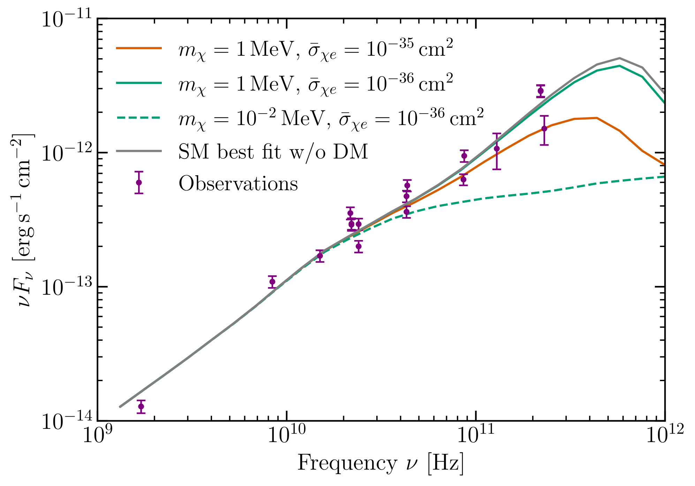

# RIAF-DM: Dark Matter–Electron Scattering in Radiatively Inefficient Accretion Flows

We incorporate energy exchange through dark matter–electron scattering into the original [riaf-sed](https://github.com/rsnemmen/riaf-sed) code developed by Rodrigo Nemmen to compute the resulting spectral energy distributions (SEDs) of radiatively inefficient accretion flows.



Figure: The curves correspond to the SEDs calculated for the RIAF around the black hole at the center of galaxy M87, with and without DM–electron scattering. The data points with error bars show measurements obtained with the EVN, HSA, VERA, EAVN, KVN, VLBA, GMVA, ALMA, SMA, and EHT, carried out quasi-simultaneously with the 2017 EHT campaign and compiled in [The EHT MWL Science Working Group et al. (2021)](https://doi.org/10.3847/2041-8213/abef71).

## Model description

We retain the stationary, two-temperature RIAF framework of the original code and add an energy-exchange channel through dark matter–electron scattering. The electron energy equation becomes

$$
q_{\mathrm{adv},e}
= \delta q^+ + q_{ie} - q^- - q_{\chi e}.
$$

The terms $\delta q^+$, $q_{ie}$, and $q^-$ describe direct viscous heating of electrons, Coulomb energy exchange with ions, and radiative cooling, respectively. The new term $q_{\chi e}$ is the net electron energy-loss rate per unit volume due to the dark matter–electron scattering. The additional energy-exchange term modifies the electron temperature profile, thereby altering the SED computed using the synchrotron, bremsstrahlung, and inverse-Compton processes implemented in the original code.

### Model parameters

The standard RIAF parameters follow the original model. The additional parameter `sigmadm` represents the combination $\bar{\sigma}_{\chi e} m_A^4$ in Eq. (7) of our paper in the heavy mediator limit, where $m_A$ is the mediator mass. Setting `sigmadm=0.d0` disables the additional energy-exchange term.

### Tabulated energy-exchange rate

The file [cooling-data/cooling_rate.dat](cooling-data/cooling_rate.dat) provides the thermally averaged cooling rate per electron on a discrete grid of radius and electron temperature. The rates are given in $\mathrm{MeV\,s^{-1}}$, radii in units of the gravitational radius $r_g=GM_{\mathrm{BH}}/c^2$, and temperatures in K.
The tabulated rates correspond to a reference value of `sigmadm=1.d-30`. During the calculation, the code interpolates the table at the local radius and electron temperature and rescales the cooling rate by `sigmadm`$/10^{-30}$.

Model-dependent parameters, e.g. the DM mass, mediator properties, and assumed DM distribution only affect the values in the precomputed cooling-rate table.

## Requirements

- Fortran compiler (e.g., gfortran) with OpenMP support
- Perl with modules `Math::Derivative`, `Chart::Gnuplot`
- Optional: Gnuplot for diagnostic plots

To install the required Perl modules use the commands:

    cpan App::cpanminus
    sudo cpan Math::Derivative
    sudo cpan Chart::Gnuplot

## Installation

To compile the routines, please clone this repository in your machine and then issue these commands inside the repo folder:

    cd fortran
    make

The Fortran binaries will be located inside the `fortran` dir. The Perl binaries are in the `perl` dir.

## Usage

### Model setup

Edit [examples/largeR_DM.dat](examples/largeR_DM.dat) to set the RIAF parameters and the DM parameter `sigmadm`.
To use a different DM model, replace `cooling-data/cooling_rate.dat` with the corresponding table computed for the reference value `sigmadm=1.d-30`. Ensure that `cooling-data/radius.dat` and `cooling-data/Tem.dat` match its radius and temperature grids.

### Compute the SED

After compilation, run the following command from the repository root:

```bash
cd test_movingDM
./run.sh
```

This uses the parameters in `examples/largeR_DM.dat` by default.

The script copies the selected parameters to `test_movingDM/in.dat`, prepares the required data files, and runs the dynamics and spectrum calculations in sequence.

### Output files

Results are saved in `test_movingDM/`:

- `spectrum.dat`: the SED including Comptonization.
- `ses5.dat`: the SED without Comptonization.

Copyright (c) 2026 Ran Ding, Ningqiang Song, Cong Zhang. Licensed under the [MIT License](LICENSE.txt).
